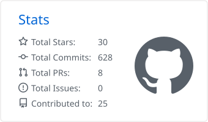
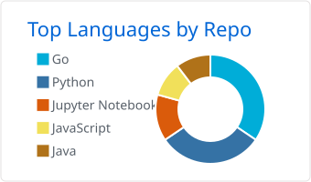
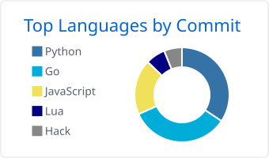

<p align="center">
  <a href="https://vasubansal1033.github.io/recruiter/">
    
  </a>
</p>

<p align="center">
  <a href="https://calendar.app.google/BXzB9rtHZ8mZFWbD9"></a>
  <a href="https://vasubansal1033.github.io/recruiter/"></a>
  <a href="https://vasubansal1033.github.io/"></a>
  <a href="https://www.linkedin.com/in/vasub-iitk/"></a>
  <a href="mailto:vasubansal1998@gmail.com"></a>
</p>

---

### 👋 About me

```go
vasu := Engineer{
    Now:       "MTS-3 @ Nutanix · backend + infra",
    Before:    []string{"Gojek", "Deloitte"},
    Education: "IIT Kanpur · Mechanical + Aerospace",
    Stack:     []string{"Go", "Spring Boot", "Kafka", "Postgres", "Redis", "K8s"},
    Learning:  []string{"LLM internals", "tokenizers", "agents"},
    OpenTo:    []string{"AI platform", "backend", "infra", "data eng"},
}
```

- 🏗️ **Nutanix:** leading the IAM control-plane migration across Kubernetes, Helm, Envoy and OIDC.
- ⚡ **Gojek:** built a multi-tenant KYC platform orchestrating ML models on an actor-concurrency framework, running on Kafka, Postgres, Redis and Kubernetes.
- 🧠 **Next:** moving into AI platform work by building GPT from scratch, training tokenizers and shipping LLM agents in public.
- 🏠 **Off the clock:** reading system internals (Go's memory model, Redis, databases) and running a self-hosted homelab on Proxmox + Tailscale.

---

### 🛠️ Tech stack

| Area | Tools |
| :-- | :-- |
| **Backend & data** |   |
| **Infra & platform** | <br/>   |
| **AI / ML** *(learning)* | <br/>   |

---

### 🤖 AI projects

| Project | What it is |
| :-- | :-- |
| [**Recruiter agent**](https://github.com/vasubansal1033/recruiter-agent) | Paste a JD, ask a question, get a fit answer grounded in my profile docs. Powers the "Ask" widget on my [recruiter page](https://vasubansal1033.github.io/recruiter/). `Python` `Gradio` |
| [**S2 tokenizer**](https://github.com/vasubansal1033/s2-tokenizer) | English, Hindi, Punjabi and Telugu BPE models sharing one 10k-token vocabulary. [Write-up ↗](https://vasubansal1033.github.io/posts/multilingual-tokenizer/) `Python` |
| [**GPT from scratch**](https://github.com/vasubansal1033/building-gpt-from-scratch) | A small GPT-style language model, following Karpathy's "Let's build GPT". `PyTorch` |
| [**makemore**](https://github.com/vasubansal1033/building-makemore) | Character-level language models from Karpathy's makemore series. `PyTorch` |
| [**vocab-coach**](https://github.com/vasubansal1033/vocab-coach) | Agentic AI workflows to help improve vocabulary. `Python` |

### ⚙️ Systems built from scratch

| Project | What it is |
| :-- | :-- |
| [**Redis server**](https://github.com/vasubansal1033/coding-challenge-redis-server) | A Redis server implementing the major Redis features. `Go` |
| [**Distributed txn DB**](https://github.com/vasubansal1033/distrib-txn-db) | Transactional KV store: hybrid logical clocks, MVCC, intents, serializable transactions. `Java` |
| [**LSM trees**](https://github.com/vasubansal1033/cascade) | Storage engines with SSTables and compaction, built twice: [Go](https://github.com/vasubansal1033/cascade) and [Rust](https://github.com/vasubansal1033/mini-lsm-starter). |
| [**SQL query engine**](https://github.com/vasubansal1033/query-engine-from-scratch) | From handwritten plans to pipelined, vectorized execution. `Python` |
| [**K8s operator**](https://github.com/vasubansal1033/echo-operator) | Custom resources and reconciliation loops with controller-runtime. `Go` |
| [**MIT 6.5840**](https://github.com/vasubansal1033/6.5840) · [**CS144**](https://github.com/vasubansal1033/cs144) | Raft, MapReduce and TCP/IP course labs. `Go` `C++` |
| [**Docker**](https://github.com/vasubansal1033/codecrafters-docker-go) · [**BitTorrent**](https://github.com/vasubansal1033/codecrafters-bit-torrent) · [**DNS**](https://github.com/vasubansal1033/codecrafters-dns-server) | Rebuilding familiar tools to see how they work. `Go` |

---

### ✍️ Latest from the blog

- 🔤 [**Multilingual tokenizer fertility**](https://vasubansal1033.github.io/posts/multilingual-tokenizer/): fertility per language and a live encode playground.
- 🧮 [**Bayes' theorem and the irrational mind**](https://vasubansal1033.github.io/posts/bayes-theorem-and-the-irrational-mind/): updating beliefs correctly, and how intuition gets it wrong.
- 🧠 [**Seeing why neural networks work**](https://vasubansal1033.github.io/posts/seeing-why-neural-networks-work/): interactive visual proofs for activations, depth, embeddings and generalization.

---

### 📊 GitHub stats

<p align="center">
  <picture>
    <source media="(prefers-color-scheme: dark)" srcset="profile-summary-card-output/github_dark/3-stats.svg" />
    
  </picture>
  <picture>
    <source media="(prefers-color-scheme: dark)" srcset="profile-summary-card-output/github_dark/1-repos-per-language.svg" />
    
  </picture>
  <picture>
    <source media="(prefers-color-scheme: dark)" srcset="profile-summary-card-output/github_dark/2-most-commit-language.svg" />
    
  </picture>
</p>

---

### 🤝 Let's talk

Hiring for **AI platform, backend, infra or data engineering** roles? My [recruiter page](https://vasubansal1033.github.io/recruiter/) has a 30-second overview, my resume, and an AI agent you can ask about my fit for your JD.

<p align="center">
  <a href="https://calendar.app.google/BXzB9rtHZ8mZFWbD9"></a>
</p>


